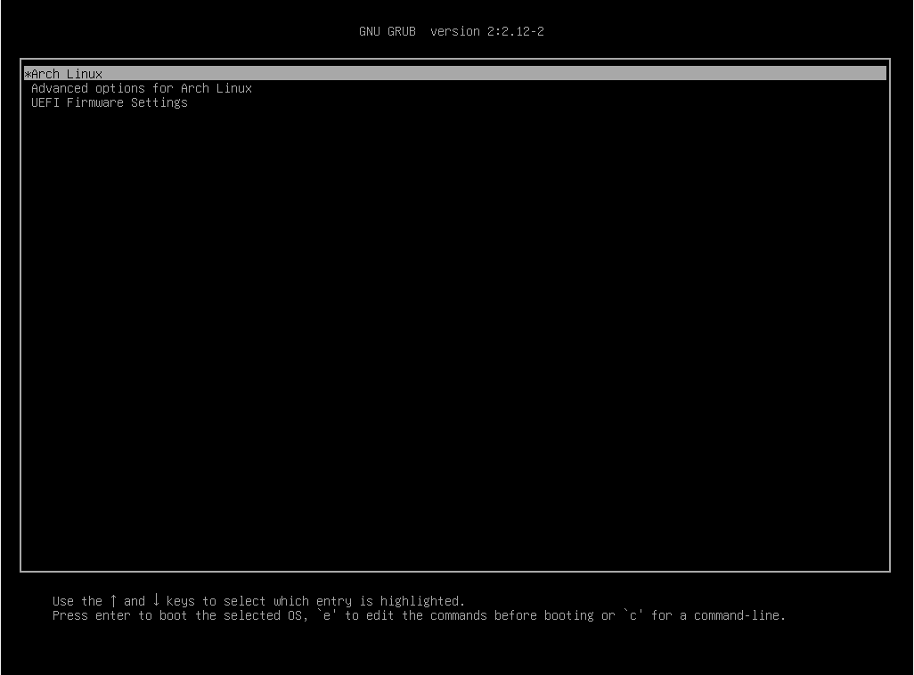
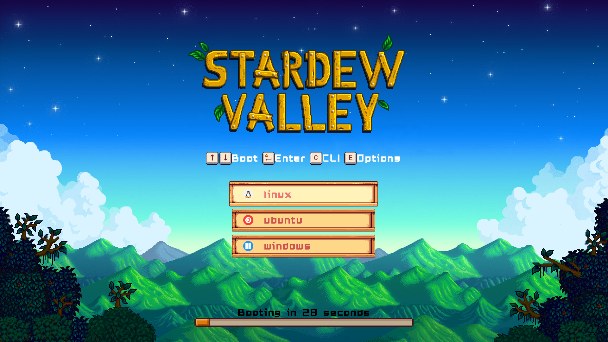

O **GNU GRUB** (*GRand Unified Bootloader*) é um gerenciador de inicialização responsável por carregar sistemas
operacionais. Em computadores com múltiplos sistemas instalados, por exemplo, ele pode apresentar um menu permitindo que
o usuário escolha qual sistema deseja iniciar:



Embora sua interface padrão seja relativamente simples, o GRUB possui um sistema de temas que permite modificar a
aparência do menu de inicialização sem alterar o código-fonte do próprio gerenciador.

Os **temas do GRUB2** são conjuntos de arquivos que descrevem como os elementos gráficos da interface devem ser
apresentados na tela. Por meio deles, podemos personalizar cores, imagens, fontes, menus, indicadores de progresso e a
disposição dos componentes.

Diferentemente de uma simples imagem de fundo, um tema pode modificar praticamente toda a apresentação visual do menu.

Por exemplo, veja o tema abaixo:



Esse tema é bem legal você não acha?

## Como funciona um tema?

Um tema é definido principalmente por um arquivo de texto chamado `theme.txt`.

Esse arquivo contém instruções que descrevem os elementos gráficos da interface, suas propriedades e como devem ser
posicionados.

Por exemplo, podemos definir uma cor de fundo e o título exibido na tela:

```text
desktop-color: "#101018"
title-text: "GNU GRUB"
title-color: "#ffffff"
```

Nesse exemplo, estamos definindo três propriedades:

- `desktop-color`: determina a cor de fundo da interface.
- `title-text`: define o texto apresentado como título.
- `title-color`: determina a cor utilizada para renderizar o título.

Essas propriedades são interpretadas pelo GRUB durante a inicialização para determinar como a interface gráfica será
apresentada.

Além das propriedades globais, o arquivo `theme.txt` permite declarar componentes com suas próprias configurações,
possibilitando a criação de interfaces mais elaboradas.

## O que podemos personalizar?

O sistema de temas do GRUB2 oferece diversos elementos gráficos que podem ser combinados para construir uma interface
personalizada.

Entre os principais recursos disponíveis estão:

- **Plano de fundo:** utilização de cores sólidas ou imagens.
- **Imagens:** exibição de logotipos, ilustrações e outros recursos gráficos.
- **Textos:** personalização de fontes, cores, alinhamento e posicionamento.
- **Menu de inicialização:** configuração da aparência das entradas, dos ícones e do item selecionado.
- **Indicadores de tempo:** barras de progresso e indicadores circulares que representam a contagem regressiva para a
  inicialização automática.
- **Contêineres:** organização de componentes em estruturas verticais, horizontais ou com posicionamento por
  coordenadas.
- **Decorações gráficas:** criação de bordas, molduras e fundos utilizando imagens que podem ser redimensionadas.

Cada componente possui um conjunto de propriedades responsável por controlar seu comportamento e sua aparência.

Ao combinar esses recursos, podemos construir desde interfaces minimalistas até menus visualmente mais elaborados.

## Como os arquivos de um tema são organizados?

Um tema normalmente consiste em um diretório contendo o arquivo principal de configuração e os recursos gráficos
utilizados.

Uma estrutura simples poderia ser:

```text
grub2-theme-guide/
├── theme.txt
├── background.png
├── fonts/
│   └── OpenSans-Regular.pf2
└── icons/
    ├── linux.png
    └── windows.png
```

Nesse exemplo:

- `theme.txt` contém as definições do tema.
- `background.png` é a imagem utilizada como plano de fundo.
- `fonts/` armazena fontes no formato `PF2`, utilizado pelo GRUB.
- `icons/` contém imagens que podem ser associadas às entradas do menu de inicialização.

Essa organização é apenas ilustrativa. O GRUB não exige que todos os temas utilizem exatamente essa estrutura.

Um tema simples pode conter apenas um `theme.txt`, enquanto temas mais elaborados podem utilizar diversos arquivos de
imagem e fontes.

## Temas modificam o funcionamento do GRUB?

É importante distinguir a **aparência da interface** do **comportamento do gerenciador de inicialização**.

Os temas controlam principalmente a apresentação visual. Eles não são responsáveis por definir quais sistemas
operacionais estão instalados, como os kernels são carregados ou quais comandos serão executados para iniciar um
sistema.

Essas responsabilidades pertencem à configuração do próprio GRUB, geralmente armazenada no arquivo `grub.cfg`.

O tema utiliza as informações disponibilizadas pelo gerenciador para apresentar os elementos visuais correspondentes,
incluindo as entradas existentes no menu.

Portanto, embora possamos alterar profundamente a aparência da interface, continuamos utilizando o mesmo mecanismo de
inicialização.

Isso não significa que toda modificação seja isenta de riscos: configurar caminhos incorretos, modificar arquivos do
bootloader ou regenerar sua configuração inadequadamente ainda pode provocar problemas.

## Limitações do sistema de temas

Apesar de sua flexibilidade, o sistema de temas do GRUB2 não funciona como um navegador web ou um ambiente gráfico
completo.

Não existe suporte nativo a tecnologias como HTML, CSS ou JavaScript para construir a interface.

Em vez disso, o GRUB utiliza seu próprio sistema de componentes, propriedades e regras de posicionamento.

Isso significa que algumas operações comuns no desenvolvimento de interfaces modernas, como layouts responsivos
complexos, efeitos gráficos avançados e animações arbitrárias, não estão disponíveis da mesma forma.

Além disso, os temas são renderizados no ambiente de pré-inicialização, onde os recursos e capacidades gráficas
disponíveis podem variar conforme o hardware, a resolução e a configuração do GRUB.

Por esse motivo, compreender as limitações do mecanismo de renderização é tão importante quanto conhecer suas
funcionalidades.

## O que aprenderemos neste guia?

Ao longo deste guia, construiremos um tema progressivamente, começando com uma configuração mínima e adicionando novos
elementos a cada etapa.

Além de aprender a utilizar os componentes disponíveis, vamos investigar como o GRUB interpreta suas propriedades,
calcula dimensões, posiciona elementos e renderiza decorações gráficas.

O objetivo não é apenas reproduzir um tema existente, mas compreender o funcionamento do sistema a ponto de conseguir
desenvolver suas próprias interfaces.

Para informações técnicas adicionais, consulte
a [documentação oficial sobre o formato de temas do GNU GRUB](https://www.gnu.org/software/grub/manual/grub/html_node/Theme-file-format.html).
